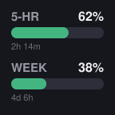
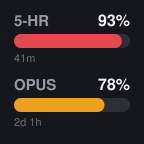
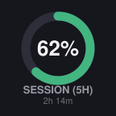
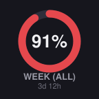
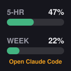

# Claude Usage Gauges (Stream Deck plugin)

Fill gauges on a Stream Deck key for Claude subscription limits: the 5-hour session window and the weekly caps. Reads the numbers from the Claude Code sign-in on the computer the Stream Deck is attached to, via the same endpoint Claude Code's `/usage` screen uses. Read-only: it never writes or refreshes tokens.

**Status: early beta (0.1.x, iterating).** Works and reviewed; expect frequent releases. The usage endpoint is undocumented and may change without notice.

<p>
  
  
  
  
  
</p>

## Install

1. Download `com.kylefsu32.claude-gauges.streamDeckPlugin` from the [latest release](https://github.com/kylefsu32/streamdeck-claude-gauges/releases/latest).
2. Double-click it. The Stream Deck app installs it (needs Stream Deck app 6.5+, Windows 10+ or macOS 12+).
3. Drag **Claude Usage Gauges → Usage Gauge** onto a key.

Requirements on the computer running the Stream Deck app:

- Claude Code installed and signed in (`claude` has been run and logged into the account you want to watch). The plugin shows whatever account that machine's Claude Code is signed into.
- macOS only: the first read may show a Keychain permission prompt for `security`. Click **Always Allow**. If macOS keeps re-prompting on newer Claude Code versions, open an issue; the fix is bundling a small signed keychain helper.

## Key settings (property inspector)

| Setting | Meaning |
|---|---|
| Views in cycle | Any of: both gauges as bars, gauge 1 alone as an arc, gauge 2 alone as an arc |
| Gauge 1 / Gauge 2 | Session (5-hour), Week (all models), Week (Opus), Week (Sonnet) |
| Show text | Toggle the percentage, the gauge label, and the time-until-reset independently; all off gives pure gauges |
| Fill style | Threshold colors (green/amber/red), a single custom color, or a custom gradient |
| Colors | Fill color pickers plus a background color; text flips dark automatically on light backgrounds |
| Refresh every | 1 to 15 minutes (a shared 55s floor protects the API either way) |

Press the key to switch to the next enabled view (remembered across restarts). Hold the key about a second to refresh immediately (rate-limited to once per 10s). A key with a single enabled view refreshes on any press.

## What the key shows

- Fill = percent of the window used, colored green, then amber at 70%, red at 90%.
- `--` = that metric does not exist on this plan (e.g. no separate Opus cap on Pro).
- **Press: open Claude** = the stored token expired. Press the key: a terminal opens running `claude`, and the key recovers on its own within a couple of minutes once the token refreshes. The plugin deliberately never refreshes tokens itself, because Anthropic rotates refresh tokens on use and a plugin-side refresh would sign Claude Code out.
- **Press: sign in** = no credentials found on this machine. Press the key to open a terminal running `claude` and log in.
- **Offline** / **HTTP nnn** = network or API trouble; the last known numbers stay on screen.

## Development

```
npm install
npm run icons      # regenerate PNG icons
npm run build      # bundle to com.kylefsu32.claude-gauges.sdPlugin/bin/plugin.js
npm run preview    # render sample key faces to preview/
npx @elgato/cli validate com.kylefsu32.claude-gauges.sdPlugin --no-update-check
npx @elgato/cli pack com.kylefsu32.claude-gauges.sdPlugin -o dist -f --no-update-check
```

Notes for future changes:

- The usage endpoint (`GET https://api.anthropic.com/api/oauth/usage`) is undocumented; it requires `anthropic-beta: oauth-2025-04-20` and a `User-Agent` starting with `claude-code/`, and its fields are all optional/nullable. Parse defensively.
- Credentials live in the macOS Keychain item `Claude Code-credentials` or `~/.claude/.credentials.json`; `claudeAiOauth.expiresAt` is epoch milliseconds.
- The Stream Deck SVG renderer only handles conservative SVG (flat fills, no gradients/filters), and the hardware bezel hides roughly the outer 12px of the 144px canvas.

## License

[MIT](LICENSE)
