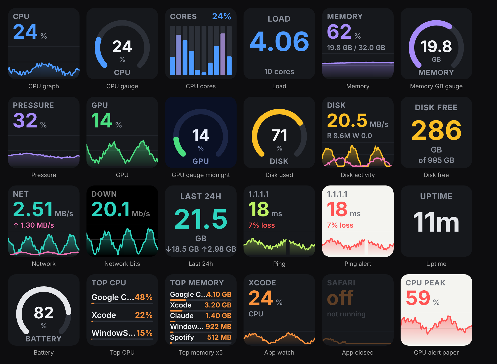

# System Vitals

Live Mac system stats on Stream Deck keys: CPU, memory, GPU, disk, network,
ping, battery, and the apps using the most. Each key is a small live tile with
a graph that scrolls right to left, a ring gauge, or just a big number.



Everything is read from tools that ship with macOS (`vm_stat`, `sysctl`,
`ioreg`, `netstat`, `ping`, `ps`, `pmset`). No sudo, no helper app, no
kernel extension.

## Keys

| Key | Shows |
| --- | --- |
| **CPU** | Total usage, busiest core, a bar per core, or the 1‑minute load average |
| **Memory** | Used (% or GB, counted like Activity Monitor: app + wired + compressed), memory pressure, swap |
| **GPU** | Apple Silicon GPU usage, renderer and tiler usage, GPU memory in use |
| **Disk** | Space used or free on any volume, or live read / write speed across all drives |
| **Network** | Download + upload speed (all Wi‑Fi & Ethernet, or one adapter), and totals for the last 60 s, hour, and 24 h. The hour and day totals are saved to disk, so they survive a restart |
| **Ping** | Round‑trip time to any host at an interval you pick, with packet loss over the last 30 pings. Lost packets show as gaps in the graph |
| **Uptime & Battery** | Time since boot, or battery charge with time left / charging state |
| **Top Apps** | The 1–5 apps using the most CPU or memory. Helper processes are folded into their app, so Chrome's renderers count as Chrome |
| **App Watch** | CPU or memory for one app you pick from a list of what's running. The key fades out while the app is closed |

Every key also has:

- **Style**: live graph, gauge, or big number.
- **Theme**: Graphite, Black, Midnight, or Paper (light), plus an accent colour.
- **Turn red above**: an alert threshold in the metric's own unit.
- **Graph span**: 20 seconds to 2 minutes of history.
- **On press**: open Activity Monitor (default), step to the next metric, or nothing.

Sampling keeps running for ten minutes after a key leaves the screen, so
switching pages or folders and coming back finds the graph still full. CPU
and memory sample from launch, so new keys start with history.

## Not included

Temperatures and fan speeds. On Apple Silicon they're only readable as root
(`powermetrics`) or through a private framework from a native helper, which
would break the "nothing to install" rule. It's the obvious next thing to add
if that trade is worth it.

## Develop

```bash
npm install
npm run build        # bundles to com.kylefsu.system-vitals.sdPlugin/bin
npm test             # parser, ledger, hub, and render tests (any OS)
npm run probe        # prints live readings from this Mac, to compare with Activity Monitor
npm run preview      # renders every key face to dist/preview.html from fake data
npm run validate
npx streamdeck link com.kylefsu.system-vitals.sdPlugin
```

`node tools/make-ui.mjs` regenerates the nine property inspector pages, and
`npm run preview && npm run icons` regenerates the PNG assets (needs
Playwright's Chromium).

## Layout

- `src/collectors/` — shells out to the macOS tools; `parse.ts` holds the pure parsers.
- `src/sampler/hub.ts` — one shared scheduler. Keys say what they need on each paint; sources start on demand and stop when nobody has asked for ten minutes.
- `src/sampler/ledger.ts` — per‑second and per‑minute network totals, persisted under `~/Library/Application Support/com.kylefsu.system-vitals/`.
- `src/metrics.ts` — maps each key's settings to series and a face.
- `src/render/` — SVG key faces (kept to what Stream Deck's SVG Tiny renderer handles).
